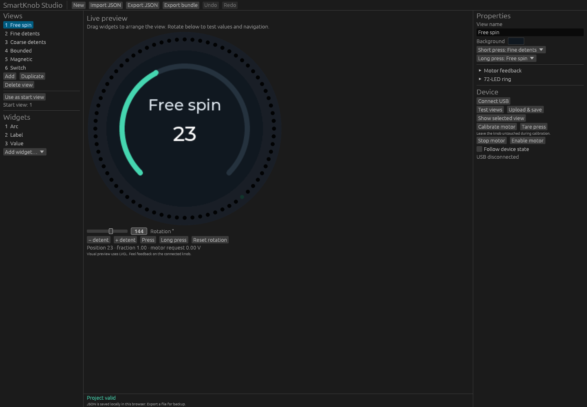
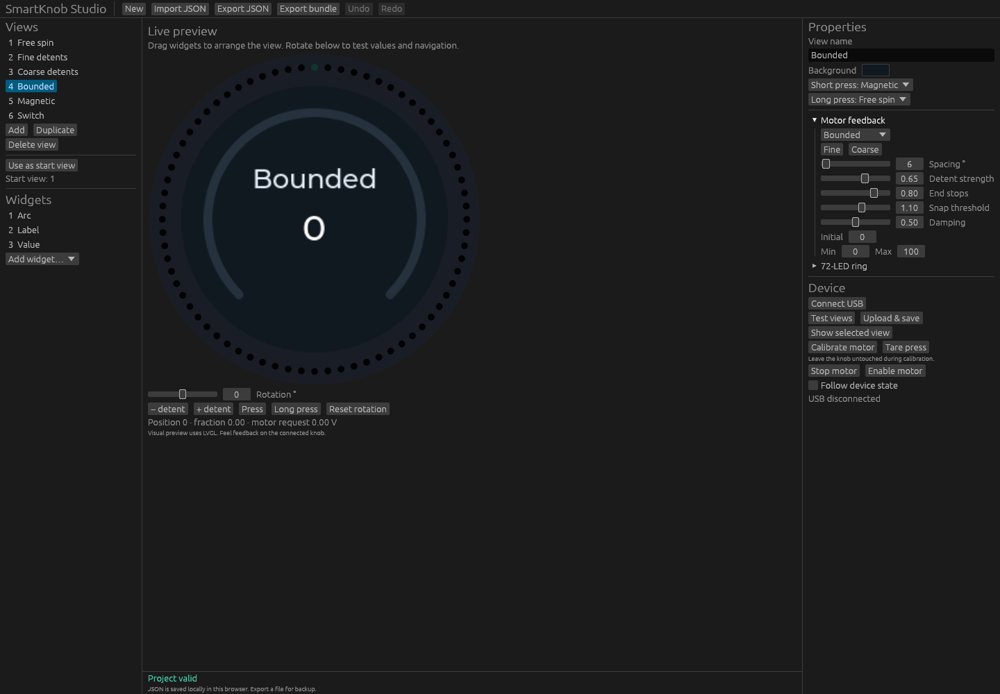
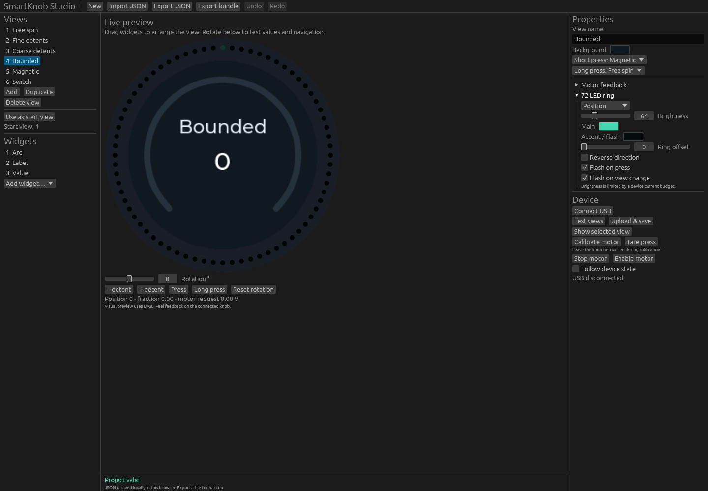
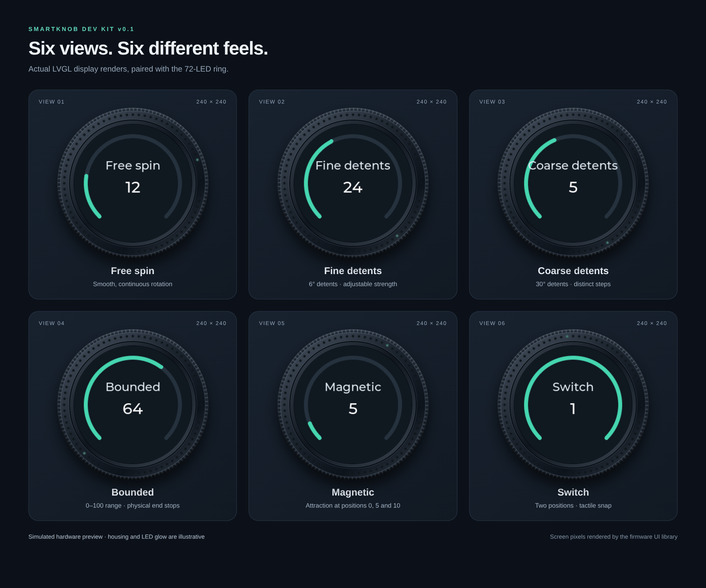

# Editor screenshots and SmartKnob view previews

Captured on 2026-10-20 from the actual Rust/WASM editor and LVGL renderer. No physical SmartKnob was connected. The hardware mockup uses actual display pixels and ring positions/colors from the firmware's renderer; the housing and LED glow are illustrative. Physical brightness and display color quantization will differ.

## Editor overview



## Motor feedback settings



## LED ring settings



## SmartKnob display mockup



The six display textures are also available at their native 240×240 resolution:

| View | Example value | Native display image |
|---|---:|---|
| Free spin | 12 | [view-1.png](view-1.png) |
| Fine detents | 24 | [view-2.png](view-2.png) |
| Coarse detents | 5 | [view-3.png](view-3.png) |
| Bounded | 64 | [view-4.png](view-4.png) |
| Magnetic | 5 | [view-5.png](view-5.png) |
| Switch | 1 | [view-6.png](view-6.png) |

## Reproduce

Build the editor with `scripts/build-web.sh`, then:

```sh
npm ci --prefix tests
cargo run --locked -p knobctl -- compile examples/demo.json web/capture-demo.skv
python3 scripts/serve.py
```

In another terminal, run:

```sh
node scripts/capture-screenshots.mjs
```

The capture script expects Chromium at `/usr/bin/chromium`; override `CHROMIUM_PATH` if needed. `EDITOR_URL` overrides the default editor address `http://127.0.0.1:8080`. The mockup is rendered with HTML/CSS and the real LVGL WASM output, with no generated or substituted screen artwork.
